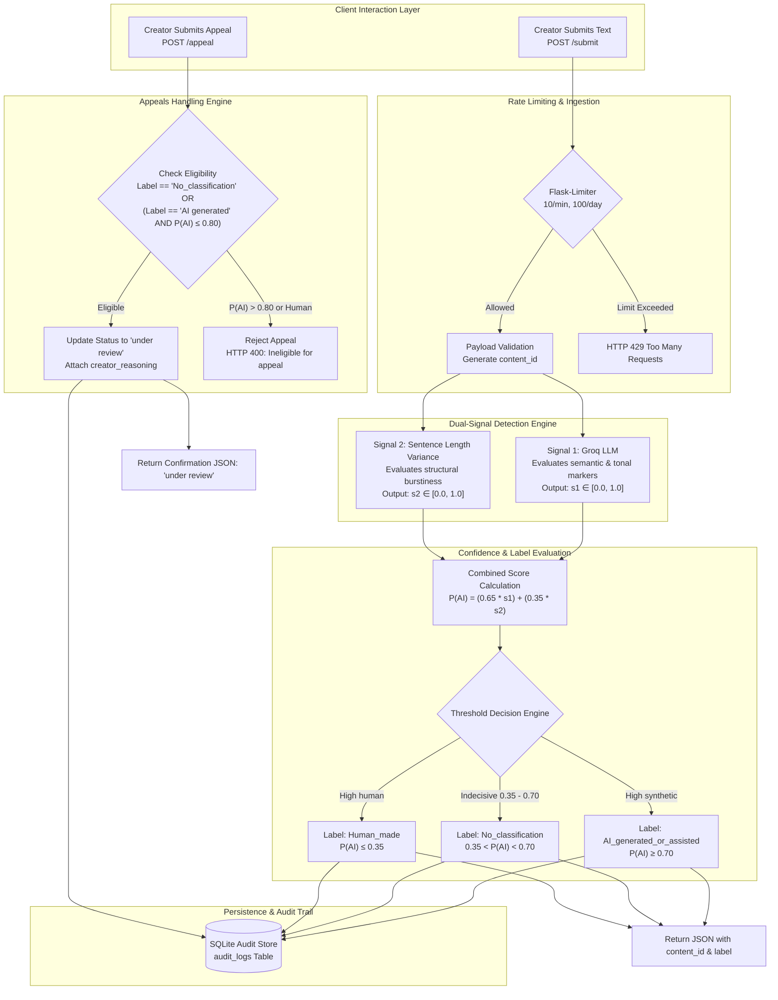

# Provenance Guard — Planning

Signal 1: ask LLM how likely on scale 0-1 this was written by AI
What it measures: Semantic cohesion, rhetorical structure, transition density (e.g., "Furthermore", "In conclusion"), and conversational hedging.
Why it differs: LLMs optimize for probabilistic average phrasing, yielding uniform semantic pacing and neutral balance. Humans introduce stylistic idiosyncrasies, irregular emotional beats, and non-linear logic.
Blind spot: Formally structured human prose (academic abstracts, corporate writing) and heavily edited AI text that strips predictable markers.
Output: A continuous float s1∈[0.0,1.0], representing the model's assessed probability that the text is synthetic.

Signal 2: sentence length variance
What it measures: The mathematical variance of sentence lengths (word count per sentence) across the submission:
Why it differs: Human writing displays high "burstiness"—short declarations interspersed with long, compound descriptive clauses. AI decoders generate sentences within a narrow, uniform length distribution.
Blind spot: Very short texts (< 50 words) where sample size is too small for statistical stability, and experimental human creative writing (e.g., minimalist repetitive poetry).
Output: Normalized float  ∈[0.0,1.0], where low variance maps close to 1.0 (synthetic uniformity) and high variance maps close to 0.0 (human burstiness).

Combined Score Calculation
P(AI)=(0.65×s1)+(0.35×s2)
We weight Signal 1 higher (0.65) because semantic analysis handles diverse genres better than purely structural variance (0.35).

Confidence for that is not decisive like .6 or .5 or .4 will be lebeled "No_classifictation" Confidence that is decisive will be labeled "Human_made" "AI_generated_or_assisted"

Anyone with a "No_classifictation" or "AI_generated_or_assisted" label can appeal the label .8 or below AI certainty when an appeal is received label will be changed to "under review" the previous classification and sinal scores will be logged so that the review has access to it

## Architecture 

Provenance Guard processes incoming creative submissions through a dual-signal classification pipeline before persisting results and returning a transparency label. Submissions entering `POST /submit` are rate-limited, evaluated sequentially or concurrently across semantic (LLM) and structural (Sentence Length Variance) signals, and combined into a calibrated confidence score. When an appeal is submitted via `POST /appeal`, the original scores and verdict remain preserved in the audit log while the user-facing status transitions to "under review".

## Uncertainty representation

`P(AI)` is the system's estimated probability the text is AI-generated or AI-assisted. 0.5 means "the signals do not know"; it is never rounded into a verdict.

| P(AI) | Internal label | Meaning |
|---|---|---|
| >= 0.70 | `AI_generated_or_assisted` | High-confidence AI |
| 0.35 < P < 0.70 | `No_classification` | Uncertain |
| <= 0.35 | `Human_made` | High-confidence human |

The band is deliberately asymmetric (wide on the "AI" side of 0.5): a false positive (calling a human's work AI) is worse than a false negative, so the system needs 0.70 before it accuses but only 0.35 to clear someone.
Extra safeguards: (a) texts under 40 words cap `P(AI)` at 0.69 (never a confident AI verdict on tiny samples, where signal 2 is unstable); (b) if Groq fails, the system falls back to signal 2 only and caps at 0.69; (c) the *displayed* confidence is the confidence in the verdict (P(AI) for AI, 1-P(AI) for human, and for uncertain `max(P, 1-P)`, which is 0.50 to 0.65; the label text never shows a number).
Signal 2 mapping: coefficient of variation of sentence length `cv = std/mean`; `s2 = clamp(1 - cv/0.8, 0, 1)` (cv 0 -> 1.0 uniform, cv >= 0.8 -> 0.0 bursty).

## Transparency label variants (exact text)

- **High-confidence AI:** "Likely AI-generated or AI-assisted. Our automated checks found strong signs that this work was produced with AI. Automated checks can be wrong. If you wrote this yourself, the creator can appeal and a person will review it."
- **High-confidence human:** "Likely human-written. Our automated checks found no strong signs of AI generation. This is an estimate, not a guarantee."
- **Uncertain:** "Origin unclear. Our automated checks could not tell whether this was written by a person or with AI. No conclusion is being drawn about this work. The creator can request a review."
- **Under review** (after appeal): "Under review. The creator has contested this label and a person is reviewing it."

## Appeals workflow

- Who: the creator whose `creator_id` matches the submission.
- Provides: `content_id`, `creator_reasoning` (required, non-empty).
- Eligible: label `No_classification`, or `AI_generated_or_assisted` with P(AI) <= 0.80. `Human_made` and P(AI) > 0.80 are rejected with HTTP 400 (a human-labeled work has nothing to contest; very-high AI scores must come through a human channel, not self-serve).
- On receipt: status -> `under_review`; the original verdict, both signal scores and the reasoning are stored together in the same record; an `appeal` event is appended to the audit log; label text switches to the under-review text.
- Reviewer queue view (`GET /appeals`): content_id, creator_id, original attribution + confidence, s1, s2, text excerpt, creator_reasoning, appeal timestamp.
- Edge cases: duplicate appeal on same content (409, no second entry); appeal for unknown content_id (404); appeal by a different creator_id (403).

## Anticipated edge cases

1. **Non-native English writers / formal prose** (academic abstracts, corporate memos): uniform sentence length and polished transitions score as AI on both signals. This is the scenario the 0.70 bar and appeals exist for.
2. **Minimalist or repetitive poetry** (short equal-length lines, simple vocabulary): sentence variance is tiny so s2 -> 1.0, and under 40 words the stats are unreliable. Capped below 0.70 by the short-text rule.
3. **Lightly edited AI text**: edits inject burstiness and strip transition markers, so both signals drift toward "human" (false negative, accepted by design).
4. Long lists / dialogue-heavy fiction: sentence splitting on punctuation distorts variance.

## Rate limiting
`10 per minute; 100 per day` on `/submit` per IP. Rationale in README.

## AI Tool Plan

- **M3** (skeleton + signal 1): give the AI the Signal 1 section + architecture diagram; ask for Flask app with `POST /submit`, `GET /log` and `llm_signal(text)` returning a float 0-1. Verify by calling the function directly on 3 inputs before wiring it in, and check it returns a float even when the model replies with extra text.
- **M4** (signal 2 + scoring): give the AI Signal 2 + Uncertainty representation + diagram; ask for `stylometric_signal(text)` and `combine(s1, s2, n_words)`. Verify the code uses exactly 0.65/0.35, the 0.35/0.70 thresholds and the caps; run the 4 sample inputs and confirm scores spread across all three bands.
- **M5** (production layer): give the AI Label variants + Appeals workflow + diagram; ask for `make_label()` and `POST /appeal`. Verify all three labels are reachable, an appeal flips status and appears in `/log`, and ineligible/duplicate appeals are rejected.
